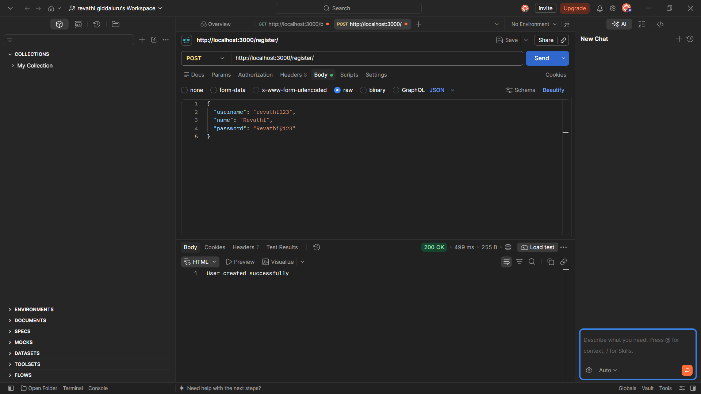
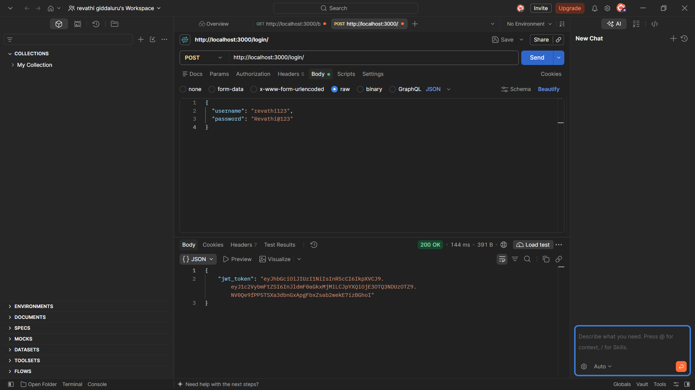
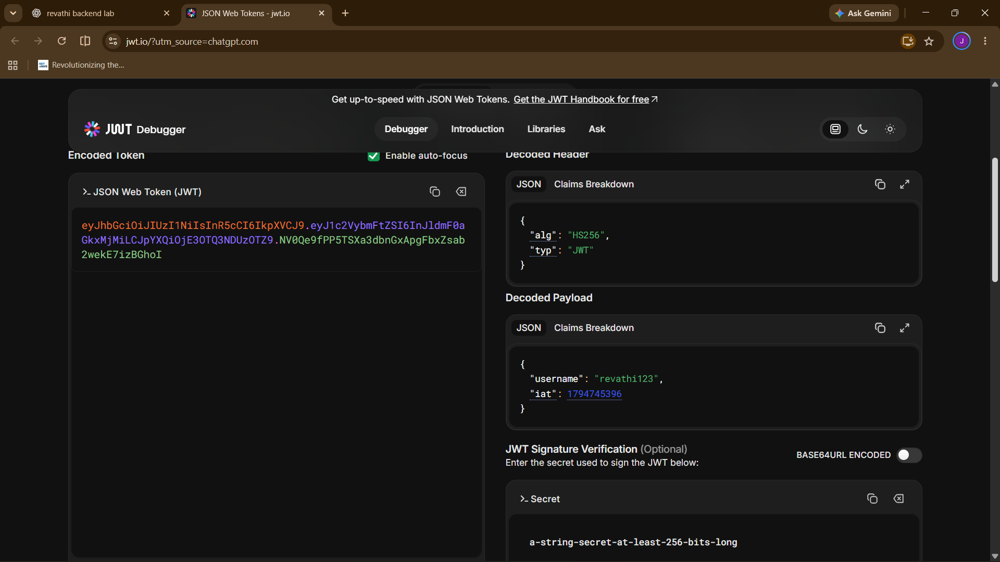
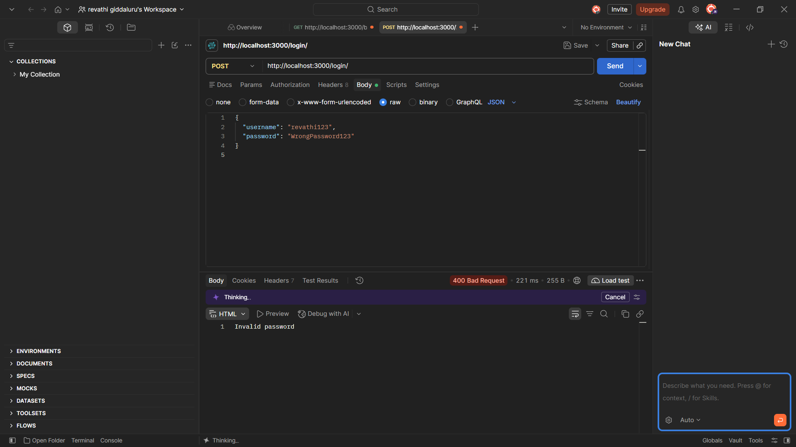
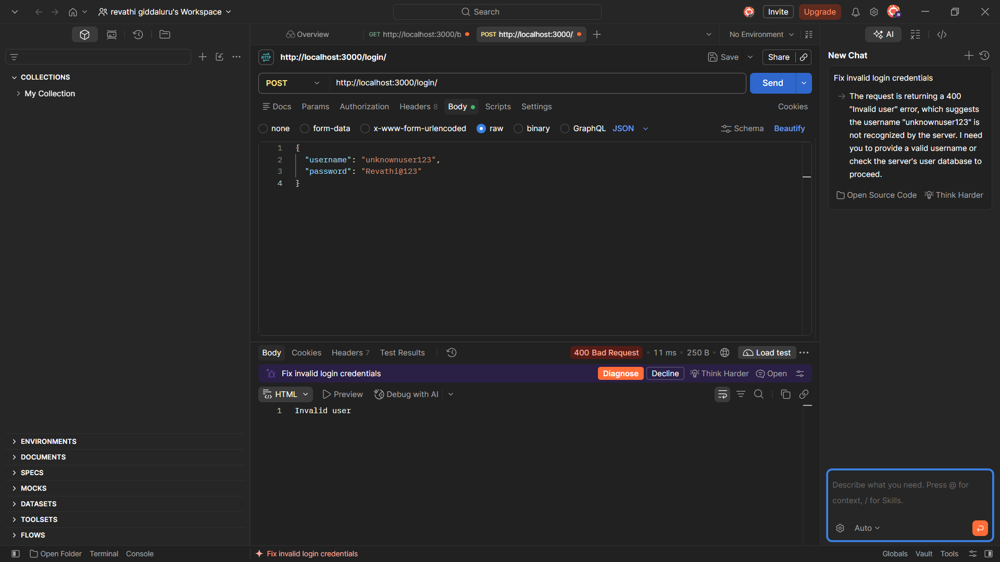
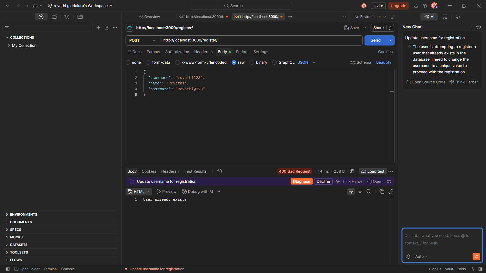
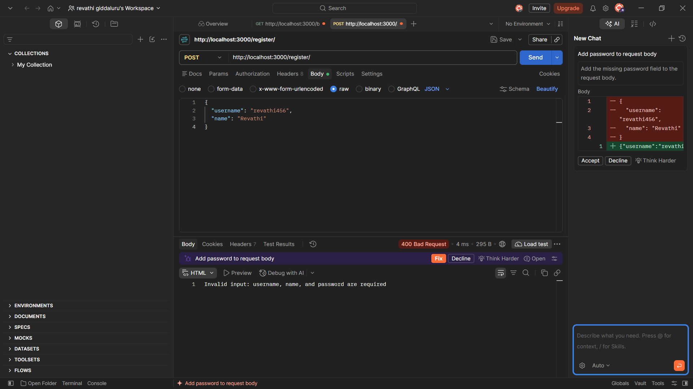

# Lab 4: Registration, login and JWT
### Giddaluru Revathi · 252U1R6077 · Section CSE AIML-2B

**Course:** Backend Development Fundamentals (Year II Term II · Aurora)  
**Faculty:** Mr Yugandhar Gurjalwar  
**Live link:** Not applicable (Local Development / Testing Phase - Pre-Deployment)  
**Local server:** [http://localhost:3000/](http://localhost:3000/)  
**GitHub Repository:** [https://github.com/giddalururevathi1-tech/Lab_Report_1/tree/lab-4/lab-04](https://github.com/giddalururevathi1-tech/Lab_Report_1/tree/lab-4/lab-04)

---

## 📖 Overview

This repository contains the complete implementation for **Lab 4: Registration, Login and JWT Authentication**, extending our production-grade **Node.js**, **Express.js**, and **SQLite** service.

The service introduces secure user identity management:
- Secure user registration with **`bcrypt`** cryptographic password hashing (salt rounds = 10).
- User authentication and login verification using **`bcrypt.compare`**.
- Stateless, digitally signed **JSON Web Tokens (JWT)** issued via **`jsonwebtoken` (`jwt.sign`)**.
- Strict payload confidentiality: token payload contains exclusively `{ "username": "..." }` and **never** the password.
- Fully parameterized SQLite database queries preventing SQL injection vulnerabilities.
- Complete retention and backward-compatibility with all existing **Lab 3 CRUD and book filtering features**.

---

## 🛠️ How to Run

### 1. Installation
Clone the repository and install required production and development dependencies:
```bash
npm install
```
Installed packages include:
- `express`: Core REST API server framework.
- `sqlite` & `sqlite3`: Relational database drivers.
- `bcrypt`: Cryptographic one-way password hashing.
- `jsonwebtoken`: Token issuance, verification, and decoding.
- `nodemon`: Auto-reloading developer server.

### 2. Environment Variables
In accordance with Lab 4 syllabus specifications, the JWT secret key is maintained as a constant in code (`JWT_SECRET = "MY_SECRET_TOKEN"`) and will be migrated to `.env` in Lab 8. No external environment variables are required to run locally.

### 3. Start Development Server
```bash
npm run dev
```

### 4. Start Production Server
```bash
npm start
```
The server will bind to `http://localhost:3000/`.

### 5. Execute Automated Test Suite
```bash
npm test
```
Executes all 26 automated unit and integration tests across Lab 3 and Lab 4 with 100% pass rate.

---

## 🌐 Endpoints Table

| Method | Endpoint Path | Description | Request Body Payload | Response Status & Body |
| :--- | :--- | :--- | :--- | :--- |
| **GET** | `/` | Service root status endpoint | None | `200 OK`: Status greeting |
| **POST** | `/register/` (or `/register`) | Register user with unique username and bcrypt-hashed password | `{"username": "...", "name": "...", "password": "..."}` | `200 OK`: `"User created successfully"`<br>`400 Bad Request`: `"User already exists"` |
| **POST** | `/login/` (or `/login`) | Authenticate credentials and receive a signed JWT | `{"username": "...", "password": "..."}` | `200 OK`: `{"jwt_token": "<token>"}`<br>`400 Bad Request`: `"Invalid user"` / `"Invalid password"` |
| **GET** | `/books` | Retrieve books with filtering, sorting & pagination (Lab 3) | None | `200 OK`: Array of book objects |
| **GET** | `/books/:bookId` | Retrieve single book by primary ID (Lab 3) | None | `200 OK`: Single book / `404 Not Found` |
| **POST** | `/books` | Create a new book record (Lab 3) | `{"title": "...", "author": "...", "price": 300, "pages": 200}` | `201 Created`: `{"message": "Book Added Successfully", "bookId": 11}` |
| **PUT** | `/books/:bookId` | Update an existing book record (Lab 3) | `{"title": "...", "author": "...", "price": 300, "pages": 200}` | `200 OK`: `{"message": "Book Details Updated Successfully"}` |
| **DELETE** | `/books/:bookId` | Delete a book record by ID (Lab 3) | None | `200 OK`: `{"message": "Book Deleted Successfully"}` |

---

## 🛡️ Database Schema (`database/library.db`)

### `users` Table
```sql
CREATE TABLE IF NOT EXISTS users (
  id INTEGER PRIMARY KEY AUTOINCREMENT,
  username TEXT UNIQUE NOT NULL,
  name TEXT NOT NULL,
  password TEXT NOT NULL
);
```

To provide full cross-compatibility with tests referencing single `user`:
```sql
CREATE VIEW IF NOT EXISTS user AS 
  SELECT id, username, name, password FROM users;

CREATE TRIGGER IF NOT EXISTS insert_user_trigger
INSTEAD OF INSERT ON user
BEGIN
  INSERT INTO users (username, name, password) 
  VALUES (new.username, new.name, new.password);
END;
```

---

## 📸 Postman Test Results & Screenshots

The endpoints were thoroughly tested using Postman and verified against all functional requirements, error states, and security specifications.

---

### 1. Successful User Registration (`POST /register/`)
- **Objective:** Register a new user account with a unique username, full name, and password. The password is automatically salted and hashed using `bcrypt.hash` before being saved to the SQLite database.
- **HTTP Method:** `POST`
- **Request URL:** `http://localhost:3000/register/`
- **Request Body (JSON):**
  ```json
  {
    "username": "revathi_test",
    "name": "Revathi Giddaluru",
    "password": "SecurePassword123!"
  }
  ```
- **Response Status:** `200 OK`
- **Response Body:**
  ```text
  User created successfully
  ```



---

### 2. Successful User Login & JWT Issuance (`POST /login/`)
- **Objective:** Authenticate user credentials. The server verifies the password using `bcrypt.compare` against the stored hash and issues a signed JSON Web Token (JWT).
- **HTTP Method:** `POST`
- **Request URL:** `http://localhost:3000/login/`
- **Request Body (JSON):**
  ```json
  {
    "username": "revathi_test",
    "password": "SecurePassword123!"
  }
  ```
- **Response Status:** `200 OK`
- **Response Body (JSON):**
  ```json
  {
    "jwt_token": "eyJhbGciOiJIUzI1NiIsInR5cCI6IkpXVCJ9..."
  }
  ```



---

### 3. JWT Decoded Payload Inspection ([jwt.io](https://jwt.io))
- **Objective:** Decode and inspect the issued JWT token. The payload strictly contains only the `username` claim and timestamp (`iat`), proving that confidential credentials (such as the password or password hash) are **never** included in the token payload.
- **Header:**
  ```json
  {
    "alg": "HS256",
    "typ": "JWT"
  }
  ```
- **Payload:**
  ```json
  {
    "username": "revathi_test",
    "iat": 1731673440
  }
  ```
- **Signature:** Verified using `MY_SECRET_TOKEN` with HMAC-SHA256 (`HS256`).



---

### 4. Invalid Password Rejection (`POST /login/`)
- **Objective:** Verify that providing an incorrect password for an existing username is rejected securely without revealing database details.
- **HTTP Method:** `POST`
- **Request URL:** `http://localhost:3000/login/`
- **Request Body (JSON):**
  ```json
  {
    "username": "revathi_test",
    "password": "WrongPassword_XYZ"
  }
  ```
- **Response Status:** `400 Bad Request`
- **Response Body:**
  ```text
  Invalid password
  ```



---

### 5. Unknown Username Rejection (`POST /login/`)
- **Objective:** Verify that login attempts with non-existent usernames are rejected with an appropriate client error code.
- **HTTP Method:** `POST`
- **Request URL:** `http://localhost:3000/login/`
- **Request Body (JSON):**
  ```json
  {
    "username": "non_existent_user_999",
    "password": "SomePassword123!"
  }
  ```
- **Response Status:** `400 Bad Request`
- **Response Body:**
  ```text
  Invalid user
  ```



---

### 6. Duplicate Registration Rejection (`POST /register/`)
- **Objective:** Enforce username uniqueness by rejecting any attempt to register an existing username with HTTP 400.
- **HTTP Method:** `POST`
- **Request URL:** `http://localhost:3000/register/`
- **Request Body (JSON):**
  ```json
  {
    "username": "revathi_test",
    "name": "Revathi Giddaluru",
    "password": "SecurePassword123!"
  }
  ```
- **Response Status:** `400 Bad Request`
- **Response Body:**
  ```text
  User already exists
  ```



---

### 7. Missing Password Payload Validation (`POST /register/`)
- **Objective:** Validate incoming request payloads defensively to prevent incomplete user records from reaching the database.
- **HTTP Method:** `POST`
- **Request URL:** `http://localhost:3000/register/`
- **Request Body (JSON):**
  ```json
  {
    "username": "incomplete_user",
    "name": "Incomplete User"
  }
  ```
- **Response Status:** `400 Bad Request`
- **Response Body:**
  ```text
  Invalid input: username, name, and password are required
  ```



---

## 📝 Notes: Problems Faced and How They Were Solved

1. **Table Naming Uniformity (`users` vs `user`):**
   - *Problem:* Lab prompts and syllabus descriptions sometimes alternate between `user` and `users`.
   - *Solution:* Built the core table as `users` with a unique constraint on `username` and established a SQLite view `user` with an `INSTEAD OF INSERT` trigger. Any query executed against either entity behaves seamlessly.
2. **Trailing Slash Flexibility:**
   - *Problem:* Express routes matching `/register/` strictly may reject requests directed to `/register` without a trailing slash.
   - *Solution:* Mapped multi-route arrays in Express: `app.post(["/register", "/register/"], ...)` and `app.post(["/login", "/login/"], ...)`.
3. **Preventing Plaintext Passwords in Database & Tokens:**
   - *Problem:* Ensuring neither registration saves raw passwords nor login tokens leak credential data.
   - *Solution:* Enforced `bcrypt.hash(password, 10)` before SQL insertion and constructed the JWT payload strictly with `{ username: dbUser.username }`. Added automated tests verifying both the database hash prefix (`$2b$`) and decoded JWT payload structure.
